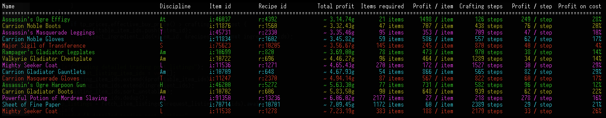
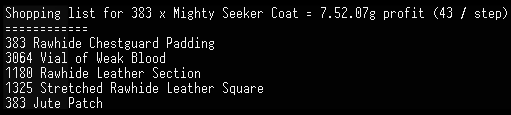

# gw2-arbitrage

[![Crates.io][crates_img]][crates_link]

[crates_img]: https://img.shields.io/crates/v/gw2-arbitrage.svg
[crates_link]: https://crates.io/crates/gw2-arbitrage

Finds items in Guild Wars 2 that can be sold on the trading post for a higher price than the cost of crafting the item.

## Usage

1. Download the latest release for your platform from https://github.com/t-mw/gw2-arbitrage/releases and extract the zip contents.
1. If running Windows, open Command Prompt or PowerShell from the Start Menu. PowerShell is the better choice on Windows 7+. If running Linux or MacOS, open your terminal application.
1. Navigate to the extracted folder using the terminal application.
1. Run the `gw2-arbitrage` binary using the terminal application (i.e. on Windows run `gw2-arbitrage.exe` from PowerShell) to produce a list of items that can be crafted and immediately resold
for profit on the trading post using materials purchased from the trading post.
The prices used assume that you buy materials at the best offer and sell the crafted items at the best bid (accounting for liquidity - see [Effects of Low Liquidity](#effects-of-low-liquidity)), so the only time
spent waiting is during crafting.
Items with high 'profit / hour' and 'profit on cost' values generally produce a higher return for the time invested.
'Time' and 'profit / hour' count crafting time and market time: moving between recipes and ingredients, trading post transactions, and the selling cooldown. A transaction covers up to 250 items, and each sale covers a single price. Sales are assumed to be made while the output is still crafting.
The list is sorted by total profit. Use `--sort hour` to sort by profit per hour instead; this only changes the order, and the amounts are still those which earn the most total profit.
To choose amounts by your time instead, pass what an hour is worth to you in gold, e.g. `--min-per-hour 15`. Each item is made in the amount that earns the most over that opportunity cost, and items that can't beat it are left out. The list is then sorted by profit per hour, unless `--sort` says otherwise.

    

1. Pass an item id as input (e.g. `gw2-arbitrage.exe 11538`) to print a shopping list for the item, which considers the total available liquidity for each ingredient on the trading post.
The shopping list will also include items that should be purchased from crafting station vendors.

    

    By default the shopping list will assume that you want to produce as many copies of the item as can be profitably sold on the trading post.
    To limit the number of items that will be crafted a count may also be passed (e.g. `gw2-arbitrage.exe 11538 --count 100` will limit the shopping list to producing 100 items).

    The small charts on the "Sell at" line and on ingredients bought from the trading post are explained in [Sparklines](#sparklines).

1. Detailed crafting instructions for the item can then be found on https://gw2efficiency.com/crafting/calculator/ or https://www.gw2bltc.com/, with the caveat that these sites do not account for [liquidity](#effects-of-low-liquidity) when crafting large amounts of items. This means that the shopping list and profits shown will not always be accurate, and you may need to adapt the crafting instructions to use exactly the ingredients printed by this tool.

**Important**: Check that you have the recipe for the item before spending any money. Some profitable opportunities listed by the tool exist because the recipes are difficult to obtain.

## Options

Run `gw2-arbitrage.exe --help` to see all available options, including CSV export.

## Effects of Low Liquidity

The shopping list may contain a mix of components (e.g. Trouser Padding) and raw materials required for that component (e.g. Bolts of Silk + Thread).
This is because the tool considers your effect on the market when you buy materials from the trading post.
For example, after buying enough Bolts of Silk and Thread to craft 100 x Trouser Padding, you may push the price of the materials high enough that it becomes cheaper to simply buy the Trouser Padding already crafted.
Similarly, the tool considers your effect on the market when you sell many items.
Although most existing tools ignore this effect, not accounting for it results in overestimating profits when crafting and selling large amounts of items.

## Sparklines

The shopping list shows a small chart such as `█▄▁▁▁▁▁▂|█` on the "Sell at" line and on each ingredient bought from the trading post.
It shows the shape of this one trade, not price history.

The bars before the `|` cover the price range of the trade, best price first: lowest to highest for ingredients, and highest to lowest for the "Sell at" line.
Each bar's height is the money spent or earned in that part of the range, relative to the tallest bar, and the lowest bar can mean little or nothing.
There are up to 8 bars, and fewer when the range is only a few copper. A trade at a single price has one bar.

The bar after the `|` uses the same scale and shows what is left just past the last price, within about one more bar's width of the range.
For ingredients this is the stock for sale just above the highest price you pay.
On the "Sell at" line it is the buy orders just below the point where crafting stops being profitable, or where `--count` stopped it.

- Bars heavy on the left: most of the trade happens near the best price and little is available after that. For ingredients, the supply is limited, so the cheap stock may be gone before you buy it.
- Bars flat or heavy on the right: there is plenty available across the range, or you are buying an exact lot.
- Low bar after the `|`: there is a gap, so the price moves sharply if you need more.
- High bar after the `|`: there is more available at about the same price, so a small change in the market is less of a concern.
- "Sell at" bars heavy on the left: most of the profit comes from the first items sold, so you can get most of it for much less crafting time. Either check the buy orders and set the amount yourself with `--count`, or use `--min-per-item` to stop at the first item that would earn too little (e.g. `--min-per-item 1000` stops below 10 silver per item). One large buy order can disappear before you finish, so check the market either way.

The "Sell at" chart is not shown with `--value`, which replaces the buy orders with a fixed price.

## Cache

The first run of the tool can take a while since all items and recipes must be downloaded from the Guild Wars 2 API.
On subsequent runs the tool will use cached versions of the item and recipe databases, stored in the system data directory. The location of the system data directory is printed in the help text for the `--data-dir` option.
The directory can be deleted to clear the cache or replaced using the `--reset-data` flag.
